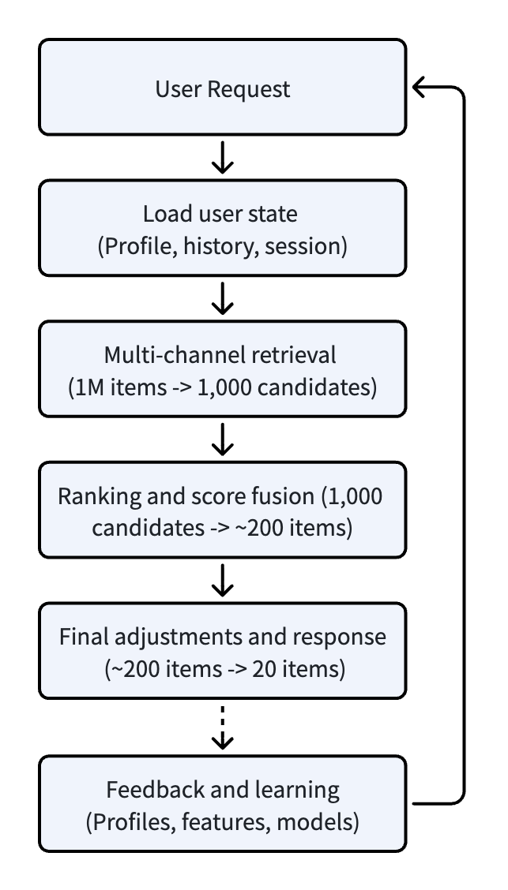

# Recommender System Architecture (1): The Big Picture

## 1. More Than Models: An End-to-End Engineering System

If you search for recommender systems online, most posts and articles are about algorithms, from deep learning to LLMs. They dig into the algorithms, break down formulas, and explain how things work in detail. By comparison, far fewer articles focus on recommender system engineering. Some discuss subsystem boundaries, module design, and the split between online and offline systems, but these discussions are usually scattered, with little sense of how the pieces fit together.

When building recommender systems for real-world use, many engineers focus heavily on improving models. They tend to assume that better algorithms lead directly to better recommendations. Some teams adopt state-of-the-art models, only to end up with disappointing results. When investigating what went wrong, they look first at the model and overlook issues caused by implementation errors or gaps in the supporting pipelines.

Having spent more than a decade working on search, content distribution, and recommender systems, I have come to see a recommender system as more than algorithms and models: it is an entire engineering pipeline.

The model is the brain of a recommender system, but it needs infrastructure and data pipelines to work. Online serving, content governance, feedback processing, and user modeling all have to work together to close the feedback loop. From an architect's perspective, a recommender system is an intelligent matching system built from these connected components. Building them is just as important as improving the models.

Algorithms and engineering depend on each other. Without reliable engineering, even a promising algorithm may never work well in production. Without effective algorithms, the system has limited ability to learn what users want.

## 2. The Goal: Finding the Right Content for Each User

A recommender system has a straightforward goal: quickly find content that interests each user from a large collection. Model upgrades and changes to recommendation strategies all serve this goal. To achieve it, the system needs to answer three questions: what to recommend, who to recommend it to, and how to do so efficiently.

### 2.1 What to Recommend: Understanding Content

Content is the raw material of a recommender system. Good recommendations start with understanding that content and organizing it in a consistent, structured form. Content understanding turns raw text, audio, video, and other inputs into features that models can use.

The system typically maintains three kinds of content features:

- **Basic content features**: Intrinsic attributes such as categories, keywords, entities, publication time, and geographic attributes. These play an important role during the cold-start phase of new content.

- **Behavioral content features**: User feedback on content, such as an article's click-through rate, reading or video completion rate, popularity, and trending score. These features accumulate as content spreads and provide an important basis for evaluating and distributing it.

- **Content quality features**: Attributes such as authority, originality, sentiment, compliance, and overall quality scores. They help identify high-quality content, limit low-quality or vulgar material, and maintain a healthy content ecosystem.

**Content standardization**: All content passes through a series of processing pipelines for ingestion, parsing, cleaning, deduplication, tag generation, and semantic vector encoding. It is then stored in a content database as a unified set of content assets, providing stable data for both online services, such as retrieval and ranking, and offline processes, such as model training and feedback processing.

In practice, some recommendation quality problems can be traced back to inadequate content understanding.

### 2.2 Who Receives the Recommendations: Understanding Users

The system also needs to understand the people receiving the content. Personalization depends on how well it models users. A mature system captures several aspects of a user's interests, including lasting preferences and what they want to browse right now. These become part of a consistent user profile.

- **Long-term interests**: Relatively stable interests learned from a user's long-term behavioral history, including positive and negative signals from clicks, browsing, and dwell time. These form the foundation of personalized recommendations.

- **Short-term interests**: Temporary preferences captured from behavior within a particular time window, such as real-time clicks and quick swipes. These help adapt recommendations to the user's current browsing context.

- **The complete user profile**: Multiple dimensions of data, including basic attributes, historical behavior tags, interest tags, behavior sequence vectors, and user embeddings. Together, they provide comprehensive user data for every stage of the recommendation pipeline.

### 2.3 How to Choose: Balancing Multiple Objectives

Recommending content means progressively filtering a large collection down to a suitable set of items. Each filtering stage involves scoring and ranking. Early in a recommender system's development, ranking typically aims to maximize click-through rate. As the system grows and user needs become more complex, click-through rate alone is no longer an adequate objective. Retention, dwell time, and engagement become optimization objectives alongside click-through rate. The system must therefore balance user experience, the platform's ecosystem, and business needs.

- **User experience objectives**: Improve positive metrics such as click-through rate, dwell time, and engagement, while preserving diversity and freshness and reducing exposure to repetitive or low-quality content.

- **Platform business objectives**: Address long-term needs such as helping new content get initial exposure, developing content ecosystems in specific verticals, enforcing compliance, and distributing traffic fairly. The aim is to balance users' immediate experience with the long-term value of the platform's ecosystem.

From this perspective, a recommender system is fundamentally an intelligent matching system that continually balances multiple objectives across users, content, and context.

## 3. Inside a Production Recommender System

A mature production system separates responsibilities into layers. Offline and online components work together, connected by data pipelines that let the system learn from feedback.

The diagram above shows an architecture used in production. We can divide it into four groups of components. Together, they take content into the system, process data, serve recommendations, and use feedback to improve future results.

### 3.1 Content Ingestion and Governance

This group corresponds to Content DB, Crawler, and Content Processing in the diagram. Content governance sits at the very beginning of the recommender system and provides the data foundation for all recommendation capabilities. Its main functions include:

- Content ingestion from all sources. The Crawler collects content from across the web and brings it into the system. In practice, content does not have to come from external sources; structured integrations with internal systems can also handle data ingestion.

- Standardized, centralized storage. Content DB, also called the Content Pool, stores all content used by the system in a centralized, standardized form for other modules to consume.

- Automated processing and governance. Content Processing consists of pipelines that automatically clean and parse content and generate the corresponding features.

These components turn unstructured raw content into consistent data that algorithms can use. Many problems with recommendation relevance and content quality arise from incomplete content understanding and governance systems. A later article will explore these topics in detail.

### 3.2 The User Feedback Loop

Feedback, Queue (Kafka), Feedback writer, Feedback Store, and Feedback System in the diagram all belong to the real-time feedback loop. User feedback is a response to recommended content and provides a direct indication of how much a user likes it. Without this loop, the system cannot learn from how users respond to its recommendations. Feedback gives it a way to improve over time.

User browsing behavior can be divided into positive and negative feedback:

- Positive feedback: Clicks, dwell time, completed reads, likes, follows, and bookmarks indicate interest in the content.

- Negative feedback: Quickly skipping an item, selecting “Not interested,” leaving the browsing experience, and reporting content indicate dislike.

Feedback events are collected asynchronously through a message queue and then written to a feedback database. Downstream offline processes transform this data into updated content features, user profiles, and improved models, which are then used in online recommendations. This closes the loop: request → recommendation → feedback → improvement → the next recommendation.

### 3.3 Offline Data Processing and Feature Generation

Offline data processing is part of the feedback loop, but it does enough work to deserve a section of its own. It corresponds to components such as Feedback System, User Profile, Feature Server, Feeder, and Candidate Pipeline in the diagram. These components do not directly handle online user requests, but their outputs directly determine how online services compute and generate recommendations.

Their main responsibilities include:

- Processing the complete set of user behavior logs: Cleaning, standardizing, and otherwise processing incoming user feedback data.

- Aggregating positive and negative feedback: Joining raw user behavior data with related data, such as basic user attributes and content features, and aggregating it into forms that downstream modules can readily use.

- User modeling: Learning user interests from positive and negative feedback. Batch pipelines produce long-term interests, while real-time pipelines produce short-term interests.

- Updating behavioral content features: As discussed earlier, features such as content click-through rate are derived from user feedback, computed by the offline data components, and written back to the content database.

- Iterative model training: Combining positive and negative feedback with other features to generate training examples, then training models on them.

This leads to a common design: combine batch processing with real-time or near-real-time processing. Batch jobs give the system a comprehensive view of the data, while real-time pipelines keep it up to date with recent behavior. Hourly and daily batch jobs process large volumes of data; their updates are slower but more comprehensive. Real-time processing updates short-term user behavior within minutes or even seconds, allowing the system to respond quickly to changes in browsing behavior.

### 3.4 Online Recommendation Services

Gateway, Realtime recommendation engine, Exploration, Candidates pool, and Feeder in the diagram belong to online recommendation services. These services handle user requests around the clock and need to return recommendations quickly. Individual components typically complete their work in milliseconds or tens of milliseconds, while the overall request generally returns within a few hundred milliseconds at most.

A typical online request follows this path: user request → gateway routing and traffic control → loading the user profile and session state → parallel retrieval from multiple channels → combined scoring and ranking → rule-based adjustments → response. We will follow this request path in more detail later in the series. For now, here are the main design considerations:

- High performance. Keep end-to-end request latency on the order of hundreds of milliseconds. For dynamic recommendation requests, systems typically use multiple cache layers, precomputation, data compression, and load balancing. Static requests are relatively straightforward and are generally served through a CDN.

- High availability. Services must operate 24/7. Online systems typically target availability of 99.9% or higher. Designs should avoid single points of dependency and consider deployment across availability zones, automatic failover, circuit breakers, and graceful degradation, with health checks to detect problems quickly.

- High scalability. Compute components use microservices and stateless architectures, together with containers and load balancing, to scale automatically as traffic grows. Storage components, such as caches and indexes, use sharding and replicated reads and writes to prevent single points of failure and increase overall throughput.

- Modular design. Retrieval, preliminary ranking, fine ranking, and reranking are decoupled. Each stage supports multiple algorithms that can be combined in A/B tests. Standardized interfaces between modules make it easier to support new business scenarios and improve existing ones.

- Security and compliance. Protect against recommendation manipulation, data leakage, and unauthorized access. Model outputs must also avoid discriminatory or sensitive content.

- Cost and efficiency trade-offs. More accurate models can improve recommendations but may slow inference, requiring a balance between accuracy and performance. Cache hit rate and recommendation quality present another trade-off. System design must balance user experience, implementation complexity, and cost.

- Observability and monitoring. Distributed tracing, metrics instrumentation, log aggregation, and anomaly alerts all need to be considered in online system design to guard against sudden production issues.

### 3.5 Offline Learning and Online Decision-Making

The architecture becomes easier to follow once we understand how offline and online components divide the work. A recommender system must find a few dozen items suited to a user's immediate browsing needs from a vast collection. Doing all of this work online would make response times far too long. At the same time, it needs to serve many users at once. To keep up with that traffic and still respond quickly, systems commonly divide the work into “offline learning” and “online decision-making.”

- **Offline systems handle “learning”**: They perform work that involves large datasets and expensive computation, such as processing complete logs, producing features at scale, building user profiles, iteratively training models, and generating candidate sets in batches. Their outputs feed the online system.

- **Online systems handle “decisions”**: They use precomputed offline results to serve user requests with low latency and high concurrency. Examples include loading user profiles, retrieving candidates through multiple channels, preliminary and fine ranking, and applying business rules. These operations reuse precomputed assets while also using the current request, session context, and user-tower encodings computed within the request. In this article, “offline” broadly means data production outside the request path, including both batch and stream processing; it does not mean only daily batch jobs.

Data flows connect these components into the user feedback loop described earlier. The efficiency and quality of those flows directly determine how quickly the recommender system can evolve and how reliably it operates in production.

### 3.6 A News Recommender System in Production

I helped build and improve a news recommendation system serving tens of millions of daily active users. It followed the architecture described above and operated at this scale:

- Daily active users (DAU): 30 million+

- Peak queries per second (QPS): 30,000+

- Content inventory: On the order of one million items

- P95 latency: Under 300 ms, as measured in that historical project. This is a different metric from the averages and deadlines discussed in other articles.

Its layers, data flows, and services provide the practical foundation for this series.

Latency figures need to specify both the measurement boundary and the percentile. A model RPC, an engine request, the full server-side Gateway path, and client-side elapsed time including networking and rendering measure different things. References in this series to tens or hundreds of milliseconds are stage budgets or illustrative orders of magnitude. The historical project's P95 and the averages in the caching article do not constitute a single shared SLA.

## 4. Following a Recommendation Request Through the System

With the overall architecture in mind, we can now follow a real user request to see what happens inside the system.

Consider a user opening an app and pulling down to refresh the recommendation feed. The first five steps below form the synchronous response path. Subsequent feedback and learning form an asynchronous loop and do not count toward this request's response time.

Figure 2 shows the complete lifecycle, from a user's visit to feedback-driven learning. This is also the main path through which the recommender system continually improves.

**Step 1: Request intake and traffic control**: The user sends a request containing a user ID, device information, a scenario identifier, A/B test parameters, and other context. At the gateway, the system performs authentication, rate limiting, graceful degradation, and traffic routing to keep the service stable and manageable. As the first online component facing users, the gateway handles recommendation requests, clicks into content detail pages, and user behavior reports. It therefore needs high throughput and reliable operation.

**Step 2: Loading user state**: The gateway forwards the request, and the online recommendation engine uses the user ID to load the user's state, including the long-term profile, historical behavior sequence, and current session information. This step generally needs to complete within milliseconds.

**Step 3: Parallel retrieval from multiple channels**: Once user state is available, the system retrieves candidates from the full content collection. Mainstream recommender systems typically use multiple retrieval channels, drawing on sources such as matches to long-term user interests, popular platform content, preferences of similar users, and immediate contextual needs. Retrieval typically narrows a large collection—for example, one million items—to a candidate set on the order of 1,000 items.

**Step 4: Ranking and score fusion**: The design we will use throughout this series sends roughly 1,000 retrieved candidates directly to fine ranking, without a separate preliminary ranking stage. The engine combines model outputs and selects the top 200–300 items for reranking, producing a cached batch of approximately 200 items. If retrieval expands to around 10,000 candidates or more, a separate preliminary ranking stage can be added as the latency and compute budget permits. This is an optional extension.

**Step 5: Final adjustments and response**: The system caches a batch of approximately 200 candidates and assembles a page of 20 items for the current request. After inserting ads and cutting the list to the page boundary, it checks the latest content status, user blocks, and page constraints, records the items actually delivered, and returns the response. If filtering leaves too few items, it makes a bounded attempt to fill the gaps or returns fewer items.

**Step 6: Closing the real-time feedback loop**: After recommendations reach the user, subsequent browsing, interactions, and other behavior are collected in real time and fed into the user feedback loop. These events provide input for future data, feature, and model updates, improving the next round of recommendations.

## 5. Key Engineering Challenges

Choosing an algorithm is only part of the work. Building a system around it, keeping it reliable, and improving it over time bring their own challenges:

**Handling high traffic with low latency**: A platform with 30 million DAU may need to handle peak traffic of tens of thousands of QPS while keeping each request's latency stable within hundreds of milliseconds. These demands require multiple engineering optimizations, such as dynamically scaling stateless services, parallelizing retrieval channels, caching final and intermediate results, and accelerating model inference.

**Keeping features consistent**: Features used in offline training must align with those used in online inference. Discrepancies create training–serving skew, which can distort model scores and ultimately reduce recommendation quality.

**Responding to changing interests in real time**: Beyond their stable long-term interests, users may develop a temporary interest in something. Trending content can also surge suddenly. The system must detect these shifts within minutes and adjust recommendations quickly.

**Handling new users and new content**: New users have no behavioral history, and new content has no interaction data. Providing high-quality recommendations without this evidence is another problem the architecture must address.

**Supporting improvement and explainability**: Why did a particular item appear in the recommendations? The system must be able to explain the reason and trace the result. Models and systems also need continual improvement, and each new iteration must be compared with the existing version through online A/B tests to determine whether it actually helps. Both explainability and an A/B testing platform require explicit architectural support.

## 6. Conclusion

My experience has led me to a simple principle: **engineering makes algorithms work in production, and algorithms give the system its ability to learn and make decisions**.

Better algorithms can improve recommendations. Reliable services, clear component boundaries, working data pipelines, and a continuous feedback loop let those improvements reach users and last over time.

Engineering is often the most underestimated part of a recommender system. Models set the upper limit of recommendation quality; engineering determines whether those models can work in production and deliver business value.

Over more than a decade, I have helped build and improve search, news recommendation, content distribution, and community recommendation systems handling traffic at the scale of tens or hundreds of millions. That work has involved many practical challenges: getting systems into production, adapting them to business needs, and improving recommendation quality.

In this series, I want to share the design decisions and practical lessons from that work: how the architecture fits together, how to implement it, and how to evolve it in production.

We now have an overview of the main components and how they work together. The retrieval, ranking, and multi-objective optimization approaches used today developed through years of engineering practice. As algorithms improved, the systems around them had to evolve too.
