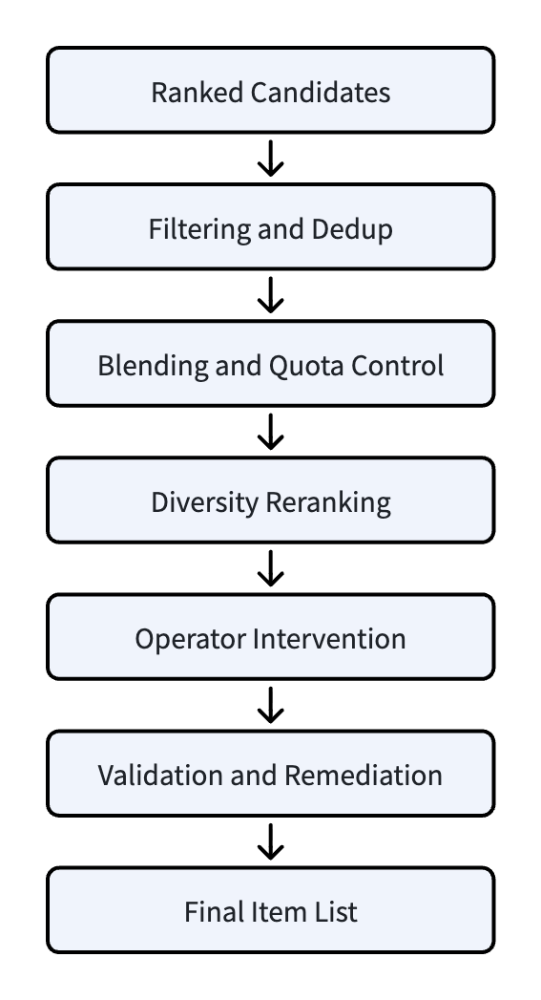

# 推荐系统架构（15）：重排，多重约束下的列表级优化

## 太长不看版

精排是给候选打分，针对的是单条内容。重排的输入是候选列表、上下文和约束，输出优化后的待分页批次。它通过列表级别的排列优化兼顾业务规则和用户体验；广告插入、分页和出口修复完成后，由 FinalizeResponse 确定最终下发列表。

重排不是一个策略大全的堆砌，是有优先级的策略 Pipeline。有些策略属于硬约束（Hard Constraint），例如过滤、置顶、位置约束、配额下限等；有些策略属于软优化（Soft Optimization），例如多样性打散、形态分布、个性化匹配等。这些策略组织成 Pipeline 依次执行，各阶段维护自身约束，最后统一校验和修复，最终形成结果列表。

本文从单条打分到列表级的范式转变，重排架构和硬约束/软优化方法论，多种重排策略介绍、策略冲突、工程化演进等方面，系统介绍这一套约束驱动的重排体系。

## 1. 重排在推荐链路中的定位

### 1.1 从单条打分到列表级排序

上一篇文章介绍了精排，它主要是从 Item 级别对候选内容进行打分。精排的输入是候选集合每一条内容的特征、用户特征和上下文特征，输出是每一条内容的多目标预估值。这里讨论的是逐条打分（Pointwise Ranking）的精排方式，每条内容的分数和其他候选无关，例如把 Item A 从列表移出，不影响 Item B 的分数计算。这种方式的优点是计算简单，可以很好地并行。

精排之后的重排阶段是列表级的重排（Listwise Re-ranking）。重排不是对单条内容进行判断，而是把整个列表作为处理对象，计算列表内各内容之间的关系，例如是否重复、是否满足配额、是否同质化等。重排阶段优化列表级的整体用户体验，它输出的不是每条内容的分数，而是经过处理的最终列表。

精排预估的是用户对这条内容的点击、停留等反馈，而重排解决的是这些内容用什么顺序、怎么组合给用户看。精排是重排的基础，重排内容的来源是精排筛选出来的优质候选集。

### 1.2 用户体验、平台生态和运营诉求

重排要平衡三方诉求，包括用户体验、平台生态和运营的诉求。所以重排只能在列表级进行处理，单条内容的处理没办法确定列表整体是否符合要求。

- **用户体验**：例如列表的内容不能大面积同质化（例如连续 5 篇都是同一分类）、低俗内容不能出现在第一屏、内容的形态要丰富（图文和视频）。这些用户体验优化的最终目标都是提升用户长期留存和消费深度。

- **平台生态**：例如首屏尽量保证优质内容（权威作者）曝光，少露出点击率高但质量低的标题党内容。低俗内容、低质内容的分发比例需要控制等等。这些措施都是为了保证平台内容生态健康。

- **运营诉求**：例如重大事件需要置顶、活动推广需要强插、新用户冷启动需要引导内容。这些运营的干预是对算法排序的人工修正，优先级高于一般业务约束和软优化，但不能覆盖安全合规要求。

这三方面的诉求有时候会冲突，比如运营强插可能会降低个性化匹配度，重排的核心就是在冲突中找到可执行的平衡点。

### 1.3 重排在链路中的位置

回顾一下推荐漏斗：`海量内容池 -> 召回（约 1000 条候选）-> 精排（Top 200~300）-> 重排`，重排位于候选生成漏斗末端，是候选生成链路的最后一个主要列表优化阶段；后续仍有页面组装和统一出口校验。

在工程上，重排表现为 Realtime Engine 的 Process Chain 中的一个或多个 Processor，运行在精排 Processor 之后。本文介绍的这些重排策略相对较轻，对上下文数据依赖比较强，因此内嵌在引擎中执行。如果重排的策略会采用列表级深度模型等计算密集型方法，可以拆分独立的重排服务，只需要把 Processor 从内嵌执行改成远程调用即可，对上下游透明。

上面说的重排可以组织为一个 Processor，也可以按类别拆分成多个 Processor。本文采用的是单个 Processor 方式，把重排当成一个内聚阶段，策略之间共享候选列表和上下文，具体的实现方式参考下一章。如果拆成多 Processor，可以复用 Process Chain 的统一治理能力，每个策略能很好地独立开关和观测。但拆成多个 Processor 之后，候选列表等需要在多个 Processor 之间传递，链路变长。

## 2. 重排整体架构

### 2.1 输入和输出

**输入：**

- **候选列表**：精排排序完之后的 Top 200~300 条内容，每条内容包括其属性（分类、关键词、作者、发布时间等等）、最终分数、各目标预估值。
- **用户、上下文特征**：用户特征（画像）、上下文特征（场景、时间等）、实验配置等。
- **约束条件**：配置中心、运营平台提供的规则和参数，包括：过滤规则、多样性参数、运营人工指定内容等。

**输出：**

- **批次候选列表**：项目中重排后取 200 条写入用户结果缓存，供本批次翻页使用；刷新可生成新批次。每条保存 generation_position（批次内位置）、内容和重排信息，以及生成请求和特征快照引用。这还不是广告插入、截页和出口修复后的最终展示列表，不能把批次内位置当作最终曝光位置。
- **特征日志（Feature Log）**：重排阶段的处理日志，例如过滤原因、位置变化、配额满足情况、惩罚分数等。这些重排阶段数据和召回、精排等日志合并在一起存入 Data Warehouse，供离线训练和分析使用。

### 2.2 重排 Pipeline

重排阶段有多种策略，是一个多阶段 Pipeline。推荐的执行顺序如下：



这个 Pipeline 设计的思路是：

- 过滤和去重（Filtering and Dedup）：包括通用过滤、聚类去重和位置相关约束的前置检查，可以在最开始缩小候选集，避免后续策略在不必要的内容上浪费计算资源。
- 混排和配额控制（Blending and Quota Control）：包括内容形态混排、等级/质量配额控制，放在多样性之前。
- 多样性重排（Diversity Reranking）：用 MMR 类贪心算法、四维打散，避免同质化内容扎堆出现。
- 运营干预（Operator Intervention）：包括置顶、强插等，这个步骤放在校验之前，避免前面的混排和多样性策略覆盖运营指定的位置，但仍须满足安全合规要求。
- 校验和修复（Validation and Remediation）：全量硬约束校验，如果部分约束被破坏（例如多样性打散可能把低俗内容移到首屏），局部进行修正。

### 2.3 重排逻辑的组织方式

如前文所述，重排阶段有多重逻辑进行处理，这些逻辑的组织方式可以放在单个 Processor，也可以放在多个 Processor，对应的工程优劣也在 1.3 节说明。本文采取的是单 Processor 方式，即在 Process Chain 中只有一个 RerankProcessor，在内部组织多重策略的顺序执行。

在 RerankProcessor 内部，所有的重排策略都实现同一个接口，以下使用示意接口描述状态提交和失败处理，不是可直接编译的完整实现：

```java
public class RerankContext {
    private List<Item> candidates;
    private UserProfile userProfile;
    private RerankConfig config;
    private RerankState state;
    private List<RerankLog> featureLog;
}

public interface RerankStrategy {
    String getName();
    boolean isEnabled(RerankContext rerankContext);
    void apply(RerankContext rerankContext);
}

public class RerankProcessor extends Processor {
    @Override
    public Response process(ExecutionContext executionContext) {
        Response response = callNextProcessor(executionContext);

        if (!response.isSuccessful()) return response;
        List<RerankStrategy> strategies = executionContext.getRerankStrategies();
        RerankContext committed = buildRerankContext(executionContext, response.getResult());

        for (RerankStrategy strategy : strategies) {
            if (!strategy.isEnabled(committed)) continue;
            if (!executionContext.canRunPhase(strategy.getName())) {
                executionContext.markSkipped(strategy.getName(), "budget");
                continue; // 后续硬约束校验仍必须执行，不能因此宣告结果合格
            }
            // 可变候选、Item 字段和 state 隔离；只读特征可共享
            RerankContext trial = committed.forkMutableState();
            try {
                strategy.apply(trial); // 长循环/RPC 内仍需真实预算控制
                validateStructure(trial); // 重复 ID、空对象、来源完整性等
                executionContext.requireActive(); // 拒绝超时后提交
                committed = trial; // 全部成功后才提交
            } catch (Exception exception) {
                executionContext.recordStrategyFailure(strategy.getName(), exception);
                // trial 丢弃，保留上一份完整状态；catch 本身不提供回滚
            }
        }

        try {
            RerankContext checked = committed.forkMutableState();
            ValidationResult result = new ConstraintValidator(checked)
                .validateAndRepair(executionContext.validationBudget());
            if (!result.safetyConfirmed() || !result.allRequiredConstraintsSatisfied()) {
                return ResponseBuilder.buildErrorResponse("Rerank constraints unresolved");
            }
            executionContext.addFeatureLog("rerank", checked.getFeatureLog());
            return response.withResult(checked.getCandidates());
        } catch (Exception exception) {
            executionContext.recordValidationFailure(exception);
            return ResponseBuilder.buildErrorResponse("Rerank validation failed");
        }
    }
}
```

示例使用“修改后提交”：各策略只修改独占的试算状态，成功后替换已提交状态；异常则丢弃试算结果。forkMutableState 不能只是复制 List，若 Item 内字段、Map 或跨策略 state 可变，也要深拷贝或 copy-on-write。可以采用其他等价的撤销方案，不要求每步复制全部只读特征。策略不得对共享缓存对象原地修改，也不应有无法撤销的外部副作用。成功策略的日志随状态提交，失败日志单独记录。

策略和规则来自请求入口固定的不可变配置快照。多样性等软策略失败可保留前一状态，但必须继续硬约束校验。安全检查失败或未知时，不允许直接放行；显式失败交给统一出口，尝试已确认有效的兜底，或少返回/空返回。只有预先声明可放宽的业务约束，且安全校验成功后，才可带降级标记返回；validator 应把放宽项、原因与剩余必需约束明确返回，不能把异常当成可放宽的业务冲突。

ConstraintValidator 自身的修复也在隔离状态上进行并受预算限制。校验失败不能输出部分修复的列表。以上代码负责批次重排；分页、广告和运营插入之后，还必须经过架构第 12 篇第 7 节定义的 FinalizeResponse，对实际页面重新校验并记录 Delivery Log。缓存命中和上层兜底都不能绕过这个出口。

### 2.4 硬约束和软优化

重排的各种策略大致可分为两类，硬约束（Hard Constraint）和软优化（Soft Optimization）。

- **硬约束**：必须满足的约束。例如违规内容、黑名单内容/域名必须过滤，否则可能引发事故；运营置顶、位置相关约束（首屏不能出现低俗内容）、配额下限（视频占比不低于 X%）也属于硬约束。硬约束的特点是二元判断（满足/不满足），优先于软优化，违反时需要修复或降级。硬约束之间也有优先级，发生冲突时按 6.3 节处理。硬约束一般采用确定性的规则逻辑实现，结果确定、可解释。

- **软优化**：没有必须达到的硬性门槛，而是在硬约束满足的前提下追求最优解。例如多样性打散，让同类内容尽量不扎堆出现。软优化类策略的特点主要是连续度量（例如多样性程度、匹配度损失等），可以通过参数控制强度（例如惩罚系数 λ）。软优化策略一般用贪心/启发式算法实现，可调参，找到近似最优解。

因此，重排 Pipeline 的设计，就是把硬约束尽量提前（过滤、配额），软优化策略放中间（多样性），运营干预放在软优化之后，再由最终校验守住安全合规等硬约束。

每条约束还需声明作用域与计数口径，不能只写一个比例或位置：

| 作用域 | 示例与含义 |
| --- | --- |
| 整批候选 | 200 条缓存候选的总体多样性或配额，不能推导每页都满足 |
| 当前页/首屏 | 本次实际下发页中的前 N 位、视频和质量配额，明确是否包含广告卡片 |
| 会话 | 同会话的运营插入次数、作者累计频次 |
| 跨页滑动窗口 | 上一页尾部与本页开头合起来检查连续重复、多样性 |

本文首屏指客户端本次页面起始可见区域，而非永远指缓存批次前 10 条；下拉刷新与继续翻页需显式区分。比如当前页有 20 个自然内容位，视频下限 10% 意味着至少 2 条视频，不能用整批 20 条视频来替代。若广告占用固定页长，分母、自然内容位数和取整规则必须重算。跨页检查读取已提交页面/有效曝光历史及其版本，并明确两种历史的用途，不能把已下发当成已曝光。

### 2.5 配置、实验和 Feature Log

**配置**：所有策略的开关和参数（惩罚系数、配额比例、过滤阈值等）都通过配置中心来管理，支持按场景和实验来设置不同值。配置变更支持热更新，可在不重启服务情况下应用新设置。

**A/B Test**：重排策略的调整，包括新增加策略、修改参数、调整 Pipeline 顺序，都应该通过 A/B Test 来验证，对比最终的业务指标和生态指标，来确定哪些策略和参数应该应用在全流量中。

**Feature Log**：重排阶段也是对用户结果的优化过程，因此在这个阶段做的所有调整都需要记录在 Feature Log 中，包括：被过滤的原因、精排位置和重排后的 generation_position、约束作用域及配额满足情况、多样性惩罚分数、运营干预标记等等。这些日志可用于离线分析策略效果，也可以用于将来列表级模型的训练样本生成。

## 3. 过滤和去重

过滤和去重一般放在 Pipeline 的第一阶段，是典型的硬约束处理，不合格的内容直接被移走，不进入后面的策略计算。

### 3.1 通用过滤

通用过滤是对单条内容属性和用户行为历史的过滤，包括：

**内容侧过滤**：

- **内容黑名单过滤**：运营明确指定的某些内容需要下线，命中直接移除。
- **标题过滤**：标题敏感词（政治、色情、暴力等），由运营维护词表，命中即过滤。还有标题党模式，通过一定规则匹配，命中可以过滤或者降权。另外一类标题长度过短或过长，根据业务需要，如果影响用户体验可以过滤。
- **链接、域名过滤**：对于一些低质量的域名黑名单，如果命中需要过滤掉。
- **失效过滤**：某些场景（例如新闻）对发布时间超过指定时间的内容进行过滤，例如时效性场景控制内容发布在 48 小时之内。

**用户侧过滤**：

- **已读过滤**：用户近期看过的/推荐过的内容，不会再推送给用户，需要过滤。已读历史可参考《第10篇》7.2 节。
- **负反馈过滤**：用户明确表示不感兴趣、或者拉黑的内容和作者，需要过滤掉。
- **已曝光降权**：对于有一些用户曝光过但未点击的内容（例如 7 天以前的曝光历史），如果再次出现在推荐列表，可以降权而不是过滤。此时的降权属于软调整，根据业务需要看要不要应用此规则。

在具体的工程实现时，过滤策略比较简单，顺序扫描一遍候选列表，检查每一条内容是否命中某条过滤规则即可。在所需属性和历史数据已准备好的前提下，这个扫描过程不依赖外部服务，速度很快。如果过滤之后候选内容不足（低于指定阈值），需要告警，触发降级兜底策略。

> 注：通用过滤，包括内容侧、用户侧的过滤，在推荐链路前面环节，例如召回等阶段也需要进行。重排阶段的过滤是为了在最终出口进行兜底，保证内容的合规性。

### 3.2 聚类去重

同一事件可能会被多个媒体源同时报道，从而产生多篇高度相似的内容。如果这些内容一起出现在一个列表中，用户体验会下降。因此需要对于相似内容进行去重。

具体工程实现时，内容在入库时会通过基于文本相似度的层次聚类、或基于实体关键词的分组等方法，生成一个 cluster_id 作为内容属性之一。重排阶段检查列表中的 cluster_id，有相同分组时，只保留分数最高的 1~2 篇，其余都移除。此处保留的数量可配置，例如重大新闻可以保留 2 篇，普通事件保留 1 篇。也可以设置策略保留不同形态的内容（图文、视频）。

聚类去重和通用过滤有明显的不一样，通用过滤是单条内容级别的判断，其内容本身不合格；而聚类去重是列表级判断，是单条内容合格但重复了，只保留其中最优质的内容。

### 3.3 位置相关约束

同一条内容在不同位置是否能展示，适用的规则不一样。首屏位置用户关注程度更高，对平台的影响更大，过滤标准应该更严格；而后续位置用户关注度相对更低，内容展示策略可以适当放宽。位置相关约束就是对这类展示要求进行控制，过滤是其中一种实现方式。这类约束也属于硬约束，但要求会随位置变化。

一个典型的位置相关约束是低俗内容分级控制。每条内容在入库时，会计算内容的低俗等级（参考第 5 篇）。低俗等级的定义：

- 0 级：正常内容；
- 1 级：轻度低俗、擦边内容；
- 2 级：中度低俗；
- 3 级：重度违规，这类内容在同步到在线库时会被拦截，不进入推荐池；

以下分级控制以内容符合安全合规要求、允许分发为前提，违规内容不能因位置靠后而放行。对于首屏（前 10 条），只能保留 0 级内容，1、2 级全部过滤；首屏往后到前 M（例如 30）条，允许一定量 1 级内容出现，但要控制比例；位置 M 之后的内容，允许 1、2 级内容在配置的比例上限内出现。

此类过滤策略依赖位置信息，在过滤阶段从前往后检查各位置对应的过滤规则。需要注意的是，如果被过滤的内容移除之后，后续内容前移，可能导致原本排在后面的内容进入前面位置，再次触发该位置过滤策略。因此该过滤策略需要多轮迭代直到列表稳定。

位置相关过滤不同于普通过滤，它虽然会在前置过滤阶段处理，但由于后续混排和多样性会再次改变内容位置，因此最终仍需由 Validation 阶段重新校验。

除了低俗内容分级控制，位置相关约束的思想也可以推广到其他场景、策略。例如首屏必须保证至少 1 条视频、首屏优质内容占比不低于 50% 等。这些策略本质上都是对特定位置范围提出更严格的要求，其中配额下限还需要通过补充或移动内容来满足，不能只靠过滤。

## 4. 内容混排和配额控制

进行完过滤之后，候选列表相对比较干净了，接下来就是配额控制，保障某些内容类型或质量等级的保底曝光。根据业务要求不同，配额控制有的属于硬约束，即必须满足下限；在没有指定硬性位置要求时，具体放在哪个位置属于软优化，在满足下限的前提下尽量合理分布。

### 4.1 为什么需要混排

精排返回的候选列表中，不同的内容形态可能分布不是均匀的。例如在新闻资讯场景中，图文内容的数量远多于视频类。如果按分数排序，会导致列表中视频内容偏少，用户的内容消费多样性下降。

混排的目标，就是在保持个性化匹配的前提下，通过策略性的调整，保证各内容形态的合理分布。当候选数量不均衡、精排分数又偏重点击率时，数量多或点击率高的内容更容易占据列表，而内容形态的多样性需要列表级的配额机制来校正。

### 4.2 视频混排

在我之前参与的资讯推荐项目中，最常见的混排场景是视频混排。即主形态是图文内容，需要将视频按策略插入到图文流中。

视频混排策略首先会设置一个视频最低占比（例如不低于 10%）。召回阶段会有单独的视频内容召回，然后统一进入精排，最后进入到重排阶段。重排阶段遍历整个已排好序的候选列表应用视频混排策略。

上面说的视频最低占比不小于 10% 属于硬约束，此外还需要控制视频分布。例如视频之间尽量间隔 N 条图文（例如 3 条），避免视频扎堆，这可以作为软优化；如果规定间隔必须达到 N 条，就属于硬约束。首屏控制，如前 5~6 条内容中至少 1 条视频、但不超过 2 条，也属于位置相关的硬约束。

具体的实现，是从头到尾逐个遍历位置，每个位置检查当前视频占比是否低于目标、是否满足最小间隔、首屏约束是否满足等。如果需要插入视频，从后续列表中取分数最高的一条往前移动。相比于在固定位置插入视频，配额驱动的视频混排方法更灵活，可以根据实际候选情况动态调整。候选不足或配额、间隔等要求无法同时满足时，需要按优先级修复或降级，不能为了凑配额放入不合规内容。

### 4.3 多内容形态统一混排

当系统中有多种形态，例如：图文、视频、图集、问答、直播等，可以对多内容混排抽象为统一框架：

- **类型标识**：每条内容的类型；
- **配额管理**：每种类型设置最低占比，可以分场景；
- **统一插入算法**：多类型并行计算，每个位置计算各类型的配额缺口，缺口最大的类型优先插入该类型下分数最高的内容；同时要满足各类型的间隔约束和位置约束（例如直播只在特定位置出现）；

### 4.4 内容质量配额

在入库时，综合内容重要性（重大事件/独家/原创）、作者权威性、内容质量等因素，系统会对内容计算内容等级（Tier），表示这条内容“平台价值”的分级。一般会分 3 级：一级（Tier 1），表示优质内容；二级（Tier 2），是普通内容；三级（Tier 3），代表低质内容。

精排模型纯按分数排序，有部分标题党内容属于 Tier 3 内容，但其点击率虚高，会占据过多位置。长期如此，会导致“劣币驱逐良币”，优质内容可能会被挤到后面位置，失去更多曝光机会。内容质量配额策略是为了保障优质内容得到更多曝光机会，让平台内容生态得到良好发展。

内容质量配额的策略，一般对前 N 篇（例如前 10 篇），保证 Tier 1 内容比例不低于 X% （例如 50%），这是硬约束。后续内容分组保障，每 M 条一组，每组内 Tier 1 和 Tier 2 内容合计比例不低于 Y%（例如 80%），Tier 3 内容不超过 Z%（例如 20%）。这个比例要求可以按场景配置，首页控制更严格，信息流页面可适当放宽。

## 5. 多样性重排

前面介绍的过滤要求和配额上下限属于硬约束，是必须满足的规则。多样性重排（或者叫多样性打散）是典型的软优化，在硬约束满足的前提下，尽量做好。多样性重排不要求同类内容绝对不相邻，而是通过惩罚机制降低同质化扎堆出现的概率。

### 5.1 多样性重排的必要性

精排模型的输入之一是用户画像，精排打分结果容易出现大批同质化内容，例如同一分类、同一作者连续出现。这些同质化的内容会导致用户兴趣窄化（信息茧房）、浏览疲劳，从而导致长期留存率下降。

多样性重排的目标是在保持个性化匹配度的同时，让列表内容更丰富多元化。不过需要注意多样性打散不是目的，过度的多样化会损失个性化匹配度，导致用户看到大量不感兴趣的内容。所以多样性打散是一个需要权衡的软目标，通过参数控制强度，然后在线上通过 A/B Test 确定最合适的全流量参数。

### 5.2 MMR 类累积惩罚

经典的 MMR（Maximal Marginal Relevance，最大边际相关性）根据当前候选与已选内容中的最大相似度进行惩罚。为与下文统一，这里用惩罚系数的写法表示每条内容的选择分数：

$$
S_{\text{MMR}}(i) = \mathrm{rel}(i) - \lambda \cdot \max_{s \in S} \mathrm{sim}(i, s)
$$

经典写法使用相关性权重 $\alpha$ 和相似度权重 $1-\alpha$；当 $\alpha>0$ 时，将整体分数除以 $\alpha$，便得到这里的写法，$\lambda=(1-\alpha)/\alpha$。因此本文的 λ 越大，惩罚越强，与经典写法中相关性权重的方向相反。

本文采用的变体是累积惩罚。与经典 MMR 只考虑最相似的一条已选内容不同，累积惩罚会考虑与所有已选内容的相似度之和，并且加入距离衰减。大概的公式如下：

$$
P(i) = \sum_{s \in S} \mathrm{sim}(i, s) \cdot \gamma^{\,d(i, s)}
$$

$$
S(i) = \mathrm{rel}(i) - \lambda \cdot P(i)
$$

符号说明：

| 符号                   | 含义                            |
| -------------------- | ----------------------------- |
| $i$                  | 当前候选                          |
| $S$                  | 已选内容集合                        |
| $s$                  | 已选集合中的内容                      |
| $\mathrm{sim}(i, s)$ | 候选 $i$ 与已选 $s$ 的相似度           |
| $d(i, s)$            | 候选 $i$ 与已选 $s$ 的位置距离          |
| $\gamma$             | 距离衰减系数，$0<\gamma<1$（如 0.9）    |
| $P(i)$               | 候选 $i$ 的累积惩罚分数                |
| $\mathrm{rel}(i)$    | 候选 $i$ 的相关分数（即精排 final_score） |
| $\lambda$            | 惩罚系数，控制多样性与相关性的权衡             |
| $S(i)$               | 候选 $i$ 的最终选择分数                |

衰减系数让较远的已选内容影响更小，避免第一条内容始终以相同强度影响后续位置。

整个选择流程可概括为：

1. 已选列表为空，候选为经过前序重排策略后的内容列表。
2. 遍历每个位置，根据上面公式对每个候选计算累积惩罚，并计算最终分数，选择最终分数最高的一条内容加入已选列表，并从候选中移除；
3. 重复后续位置，直至选满期望的条目数（例如 100），或候选耗尽。

这个过程中关键的参数包括：

- **λ（惩罚系数）**：控制多样性与相关性的权衡。λ 越大，多样性打散越强，但相关性损失也可能增大；λ 越小，则越接近纯分数排序。λ 的取值依赖精排分数和相似度的尺度，以及各维度权重，可以通过 A/B Test 找到合适的值，换系统时不能直接照搬。
- **衰减系数**：控制当前内容和已选相似内容的衰减关系。已选内容每远 1 位，惩罚乘以衰减系数。在相似度相同的情况下，最近选中的内容贡献的惩罚最大。
- **候选窗口 K**：每轮贪心选择只考虑剩余候选中按精排 final_score 排名前 K 的内容（如前 50 条），选走一条后再补入下一条。K 限制的是本轮待选范围，不是已选内容的累积惩罚范围，可以降低计算量，也减少大幅偏离精排结果的机会；若窗口内没有满足硬约束的候选，则需扩大搜索范围或转入修复。

### 5.3 相似度的四个维度：分类、发布者、关键词、自定义

前面介绍的惩罚分数，需要计算当前内容和已选列表的相似度。本节介绍我们之前的一个经验，从四个维度上计算内容相似度：

- **分类（Category）**：基于一级/二级分类计算相似度，同分类相似度高，不同分类为 0。可引入层级权重，一级相同可施加基础惩罚，二级也相同时再叠加惩罚；具体权重按业务配置。
- **发布者（Publisher）**：基于发布者计算相似度，相同发布者相似度高（如 1.0），不同为 0。权威媒体或头部作者的惩罚可适当降低，因为这些内容质量高，连续出现负面影响相对较小。
- **关键词（Keyword）**：基于关键词集合的 Jaccard 相似度或 TF-IDF 余弦相似度。
- **自定义（Custom）**：业务自定义打散维度，如内容来源类型（原创/转载/UGC）、内容风格（严肃/娱乐/科普）、地域标签等等，可以通过配置灵活扩展。

有了四个维度的相似度，然后用公式进行融合：

$$
\mathrm{sim}(i,s) = w_{\text{cat}} \cdot \mathrm{sim}_{\text{cat}}(i,s) + w_{\text{pub}} \cdot \mathrm{sim}_{\text{pub}}(i,s) + w_{\text{kw}} \cdot \mathrm{sim}_{\text{kw}}(i,s) + w_{\text{custom}} \cdot \mathrm{sim}_{\text{custom}}(i,s)
$$

其中 $\mathrm{sim}_{\text{cat}}$、$\mathrm{sim}_{\text{pub}}$、$\mathrm{sim}_{\text{kw}}$、$\mathrm{sim}_{\text{custom}}$ 分别是分类、发布者、关键词、自定义四个维度的相似度，$w_{\text{cat}}$、$w_{\text{pub}}$、$w_{\text{kw}}$、$w_{\text{custom}}$ 是对应权重。

加权求和后先代入 5.2 节的 $P(i)$，再计算 $S(i)$。各维度权重可配置，例如资讯类产品分类维度权重高，社交媒体类产品发布者维度权重高。

### 5.4 参数动态化

多样性打散的相关参数：惩罚系数 λ、各维度权重、候选窗口 K，可以根据场景、用户和上下文进行动态调整。

例如对于新用户，因为反馈数据比较少，画像不是那么精准，精排分数的可靠性相对较低，此时可以尝试加强打散效果（增大 λ）。而老用户画像相对准确，可以降低打散强度（减小 λ），也就是让个性化占主导的同时保持基本多样性。

另外也可以根据用户状态动态调整，例如有的用户兴趣广度大（兴趣标签数量多），可以适当把 λ 调小一些，充分个性化；而对于兴趣窄的用户，适当加大 λ，鼓励兴趣探索。

还可以根据场景差异进行调整，例如首页的多样性要求高一些，调大 λ；搜索结果页可按查询意图减小 λ；相关阅读列表也可以降低打散强度，是否关闭则要看同质化程度和实验结果。

## 6. 运营干预和策略冲突

### 6.1 内容置顶

在发生重大突发事件、重要政策发布或者平台重点推广时，运营会指定一条内容出现在列表最顶端。

此时运营人员在 CMS（Content Management System，内容管理平台）配置置顶和强插（下节介绍）内容，可以指定生效范围（全量/特定人群/特定场景）。推荐系统收到对应推送，重排时将指定内容直接放到列表第一位置，并扫描候选列表，如果重复需要删除。

如果出现多条置顶内容，按运营指定的优先级依次放到 1、2、3 位置，不过一般指定内容不宜超过 3 条，过多会严重影响个性化体验。

置顶内容通常经过人工审核，但仍须通过安全合规检查，不能豁免黑名单、下线等规则。通过检查后，置顶位置不受多样性等低优先级策略调整；与业务硬约束冲突时，以运营置顶为准，并记录告警日志。置顶内容通常不需要出现在精排候选中，直接从内容库中获取插入。

### 6.2 强插

对于一些专题报道、活动推广、新功能引导，运营可以指定一系列内容，按比例和策略插入到推荐流，保障曝光机会。

强插和置顶的区别，是置顶一定放置在第一位，而强插内容按策略放入到多个位置，数量更多，位置更灵活。强插内容也是由运营人员在 CMS 中配置，配置时可以指定插入比例、位置范围、生效时间等。

强插内容的插入策略可以包括：按比例插入，例如按 10% 比例插入；固定位置，例如第 4、9、14 位插入；区间随机，在指定区间内随机插入。我们之前采取的是按比例+最小间隔的方式。强插内容同样须通过安全合规检查并去重。插入后自然内容往后顺延；如果最终列表有长度上限，需要截断尾部，并在截断后重新校验位置和配额约束。

### 6.3 策略优先级

重排 Pipeline 中有多个策略，当它们有冲突时，明确策略优先级，按优先级顺序满足。前面介绍的这些重排策略优先级从高到低：

- 安全合规（黑名单过滤）；
- 运营干预（置顶、强插）；
- 业务硬约束（位置、配额等）；
- 软优化（多样性、分布均匀性、个性化匹配度）；

高优先级策略执行的结果，低优先级的策略不能覆盖。例如多样性打散不能移动置顶内容的位置；配额控制插入的视频，多样性打散可以调整视频之间的相对顺序，但不能违反全列表或首屏的配额下限；即使没有移除视频，只改变位置也可能破坏首屏配额。

综合来看，发生冲突时，按安全合规 > 运营干预 > 业务硬约束 > 软优化的优先级取舍；软优化之间通过参数权重来权衡。Pipeline 的执行顺序不等于优先级顺序，后执行的策略也不能覆盖更高优先级的约束。位置约束中如果包含安全合规要求，也应按最高优先级处理。

### 6.4 校验和修复

Pipeline 中每个策略都可能破坏其他策略的约束，例如多样性打散可能把低俗内容移到首屏。因此在 Pipeline 末尾，需要统一进行校验修复。

校验：按约束作用域检查批次或当前页面，覆盖对象完整性、来源标识，以及以下硬约束：

- 过滤检查：是否有违规内容、已读内容残留；
- 位置检查：首屏是否有低俗内容；
- 配额检查：视频占比、等级比例是否满足要求；
- 运营检查：置顶、强插的位置和数量是否符合要求；
- 去重检查：是否有完全相同的内容重复；

修复：如果校验不通过，针对硬约束策略做局部修正，不重新跑整个 Pipeline：

- 如果低俗内容出现在首屏，可与后续满足首屏要求的内容交换位置，但要确认交换后两处位置的约束都成立；没有合适内容时，应移除并尝试补足；
- 符合安全合规要求的置顶内容如果偏离指定位置，需要移回，并复查受影响的位置和配额；

修复后需要复查受影响的约束，并限制修复轮数，避免策略之间反复拉扯。硬约束无法同时满足时，按优先级取舍或触发降级；安全合规约束无法确认满足时，不能直接输出。已经进行的修复、因冲突而放宽的业务约束，以及降级结果，都需要记录日志并配置告警。

分页截尾、广告/运营插入、缓存读取后的最新屏蔽，都可能再次改变展示集合或位置。因此，批次校验通过只表示该阶段合格，最终出口仍需对实际页复查；补齐候选也必须经过同样检查，并限制补齐轮数和耗时。Renderer 不再改变顺序与集合；若下游必须改变布局，则由负责最终布局的模块重新检查并记录最终位置。

本文 2.3 中由独立的 `ConstraintValidator` 完成校验和修复，约束参数应与前序策略使用同一份请求配置，避免两套规则不一致。也可以把校验修复实现为一个 RerankStrategy，但必须保证它最终执行，且校验失败不能被通用异常隔离逻辑简单跳过。做 A/B Test 时，业务约束可按实验配置变化，安全合规底线不能随实验关闭。

## 7. 工程化和演进

### 7.1 策略配置化

- 业务策略可以配置是否启用，Rerank Pipeline 执行时检查开关。不同场景、不同实验可以配置不同的策略组合；安全合规必需的检查不能通过普通实验开关关闭。
- 策略参数（惩罚系数、配额比例、过滤阈值等），都通过配置中心管理，支持按实验分组，部分参数还可以按用户分层设置。这些配置都支持热更新生效。
- 配置变更也需要走灰度发布流程：先小流量验证，确认没问题之后再逐步放大流量。每次的变更都要有版本记录，支持回滚。

### 7.2 监控和可观测性

对重排阶段，可以增加多层的监控。

**策略层监控：**

- 过滤策略过滤的条目、比例等，如果过滤比例突变需要告警；
- 混排视频插入量和最终占比；
- 内容质量等级最终占比；
- 多样性打散位置调整幅度、惩罚系数实际生效值；
- 运营置顶/强插的触发量和曝光量；
- 策略校验、修复结果；

**结果层监控**：最终列表的分类分布、作者分布、形态分布等，和历史基线对比，分布突变时告警。

**性能监控**：重排的总延迟（平均和 P99）和各策略分阶段延迟、候选不足告警、错误率等。

**业务层指标**：策略变更之后 A/B Test 业务指标（点击率、停留时长、负反馈、留存等）以及生态指标（优质内容曝光、低俗占比、消费多样性等）。

### 7.3 性能和降级

**重排阶段的性能分析：**

- 重排输入约 200~300 条候选。假设 N 为候选数、T 为配额类型数、L 为输出条目数、K 为候选窗口、D 为相似度维度数。那么单轮通用过滤复杂度是 O(N)，逐位置扫描各类型的配额处理通常是 O(N×T)。多样性计算未经优化的复杂度为 O(L²×K×D)。
- 优化方法：对于多样性策略，可以预计算相似度矩阵，该计算需要 O(N²×D) 的计算量和 O(N²) 的存储；还可以增量维护剩余候选的累积惩罚，避免重复遍历已选列表。还可以只针对列表前 M 条（例如前 100 条）做处理，后面的内容关注度相对较低，按原顺序直接附加即可。
- 重排时间消耗优化目标一般是毫秒级，具体预算需要结合链路总预算、候选规模、实现方式和压测结果确定。如果时间消耗太多，需要对重排策略进行适当简化。

**降级：**

- 多样性等软优化策略失败时可以直接跳过，并记录告警。
- 安全合规等硬约束策略失败时，不能简单忽略，还需要通过独立校验确认约束是否成立。最终无法确认或者修复失败时，触发严格降级，即返回经过有效安全校验的兜底结果，或者少返回甚至返回空列表。业务硬约束无法满足时，根据其优先级和降级规则处理并告警。
- 重排阶段整体不可用时，精排结果也必须经过最小安全过滤和必要的硬约束校验后才能返回；如果最小策略兜底也不可用时，触发严格降级策略，不能直接透传未经校验的结果。
- 候选严重不足时，告警并尝试补充热门列表或用户缓存。

### 7.4 从规则到模型化重排

当前很多推荐系统都以规则为主，但也有一些团队在尝试新的方向：

- **列表级排序模型**：用深度学习模型直接对整个候选列表排序优化，此时的输入包括列表所有内容特征和上下文，输出的是考虑列表级优化的内容列表。模型可以学习重排规则不好表达的复杂列表级模式，比如内容间互补关系、序列效应等。但此方法的挑战在于推理成本比较高、训练数据构造起来比较困难、结果的可解释性相对较差。

- **强化学习重排**：这个方向是将重排建模为序列决策，每一个位置的选择是动作，奖励是用户的长期反馈（例如停留、互动、留存等），优化长期目标而不是单条内容的点击率。这个方法的挑战是在线探索成本很高，训练也不太稳定。

- **规则和模型混合**：对于软优化策略用模型来做，而硬约束（过滤、置顶、配额）还是基于规则。最终的校验和修复也基于规则。这种方式中，模型负责优化，规则负责兜底，兼顾效果和可控性。

### 7.5 总结

重排是一个约束驱动的列表级优化构造过程，精排给出候选列表和每条内容的分数和多目标预估值，而重排是结合上下文和约束条件，在按优先级处理硬约束冲突、守住安全合规底线的前提下优化软目标，输出最终列表。

回顾本文，单条打分到列表级优化是精排到重排的基础范式变化；硬约束、软优化分类是策略核心；过滤、配额、多样性、运营干预是四类典型的策略。最后可以一句话总结：重排本质上是把精排计算的优质候选集，在多重硬约束下，通过软优化手段，构造一个兼顾业务规则和用户体验的待分页批次；最终下发列表还需经过页面组装与 FinalizeResponse 校验。

---
## 附录：实战思考题

1. 运营要求在前 5 条中插入 1 条强插内容，但这条内容的精排分数很低。从硬约束/软优化的角度分析，强插属于哪一类？它会牺牲哪些软目标？怎么量化评估强插比例对用户体验的影响？

2. 多样性打散中，惩罚系数 λ 设置过大会导致什么问题？过小又会导致什么问题？如果让你设计一个实验来确定最优 λ，你会怎么设计？除了点击率和停留时长，还需要观察哪些生态指标？

以上问题没有标准答案，文中给出了部分实践思路，欢迎在评论区一起探讨。

> 本系列还在持续更新，建议收藏，方便后续对照阅读。

