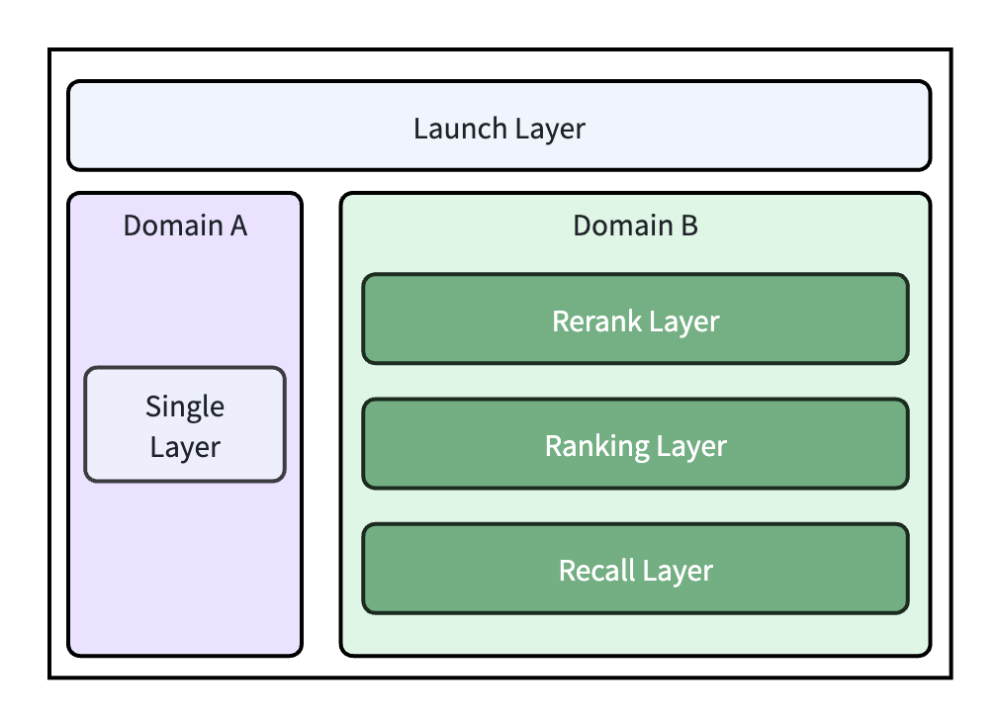

# 推荐系统架构（16）：多层实验框架，在线流量的正交复用

## 1. 从单层实验到多层实验

推荐系统涉及到很多的模型、策略的迭代，有很多团队一起协同工作。我们设想这样一个日常迭代场景：

- 一个团队在实验新增召回源，看这个新增的召回源能不能带来更多的相关内容。
- 另一个团队在修改排序算法，准备上线一个新的精排模型，看看能不能提升停留时长。
- 还有一个团队在配合前端修改展示样式，把来源显示在页面左下角。

这三个迭代由不同团队分别推进，目标不同，修改的算法、代码逻辑也不太一样。在快速迭代的节奏中，每个团队都希望自己的改动尽快上线，分配小流量验证效果。

在《推荐系统架构（11）：Traffic Splitter》文章里，我们介绍了单层 A/B Test 的做法。在一个业务场景内部，根据 user_id 哈希把流量划分到若干 Bucket 中。所有 Bucket 加 GA 占比一共是 100% 流量。如果实验不是很多的情况下，这套机制运行得非常流畅，很可靠。

但在上面这个多团队都想做线上实验场景中，会有一个显著的问题，那就是**实验之间互相挤占流量**。在单层实验框架中，所有实验都共享同一份互斥的流量预算。上面描述的三个场景，假设每个实验 5% 流量，再加上一个占 5% 流量的共享对照组，共占总流量 20%。如果各实验要继续放量到 30%，三个互斥实验加起来就占 90% 流量，留给对照和其他实验的空间很少。

多个实验有时还会存在关联关系，需要把它们的参数进行组合。继续上面的场景，如果希望覆盖召回、精排和前端样式三个改动的全部开关组合，共有 2×2×2=8 种组合，在单层模型中需要分别维护这些组合配置。如果实验数量再增加，配置数量会快速增长。多层模型可以按层维护各自的配置，减少手工组合的负担；实际的策略组合仍然存在，分析时也仍需考虑它们之间的交互。

实验数量和放量需求增加后，单层模型逐渐受到流量预算限制，因此我们基于之前第 11 篇介绍的单层实验模型，演变迭代到多层实验框架。在推荐系统初期，单层实验框架能很好地满足业务需求。而随着系统规模扩大，召回、排序、重排、样式等等多个环节都需要迭代实验时，多层框架是更合适的选择。

## 2. 多层实验组织模型

本文介绍的多层实验框架，参考 Google 发布的论文，并结合业务需求做了调整。原论文见末尾的 References 部分。

### 2.1 三层结构

多层实验框架把实验配置组织成三层： Domain, Layer 和 Experiment。

- Domain（实验域）：顶层的流量切分单元。
- Layer（实验层）：域内的分流层，一层 Layer 负责一组相关的参数。
- Experiment（实验）：层内的具体实验，带自己的流量比例和参数。

整体如下图所示：



第 11 篇中讲过，实验是在一个业务场景（首页、信息流、相关推荐）内部进行的，不同的场景是隔离的，有各自的实验组织形式。所以本篇介绍的多层实验框架，都是在一个业务场景内部。

### 2.2 实验域（Domain）

Domain 是流量组合单元，顶层所有 Domain 按 user_id 做互斥分片，流量加起来等于 100%。也就是说，一个用户经过哈希之后，在某一时刻只会落在一个 Domain 中。

不同的 Domain 内部，可以选择不同的分层结构。例如：Domain A 只设置一个实验层，可以测试同时修改多个环节参数的整体策略，其内部类似之前的单层实验模型。Domain B 内部分召回、精排、重排三层并行的实验，每层可以进行自己这一个环节的实验，并行迭代。

单层和多层的域并存，分别支持跨环节的整体策略实验，以及各环节的并行迭代。

### 2.3 实验层（Layer）

Layer 是这个多层实验框架的核心，一个 Domain 内部可以分为多个 Layer。不同 Layer 之间有两个关键的性质：

- **层间独立分流**：每个 Layer 可以设置独立的 HashSeed，流量划分时用 user_id + HashSeed 做哈希分桶。因为 HashSeed 不一样，同一个用户在不同层的分组近似独立。这就是“正交”，召回层跑的实验，不会改变精排层的分桶结果，同一份流量在每一层都被独立复用了一遍。

- **参数归属明确**：不同 Layer 管理不同的参数。例如召回层实验只负责召回相关的参数；精排层实验只改动排序相关参数。这样用户在不同层命中不同的实验，这些实验修改的参数不会重叠，可以按各层的实验分组比较指标。

在推荐系统中，Layer 天然可以对应到不同的环节，召回层、精排层、重排层、UI 层。因为这些环节本身就有其独立的参数，迭代节奏可以不一样。

不过需要注意的一点，独立分流并不一定意味着策略效果之间不会互相影响，正交只保证流量分桶结果相互独立，不保证业务效果互不影响。例如，召回层新增了一个召回源，其召回候选集变了，精排层计算的点击率等预估可能就会随着变化。在进行实验分析时，要谨记着这条规则，层之间可能会存在相互的业务影响。

> 本文介绍的模型参考 Google 论文，原模型允许 Layer 中继续嵌套 Domain。我们当时的实现也保留了 Domain 嵌套的能力。不过回顾所有实际线上业务配置，并没有真正的场景使用这个嵌套。所以本文聚焦在最常用的 Domain -> Layer -> Experiment 三层结构，不展开嵌套 Domain 部分。

### 2.4 实验（Experiment）

一个 Layer 中包括多个 Experiment。Layer 内部就是一个单层实验模型，和第 11 篇中介绍的基本一致。所以之前的单层实验模型，可以看成多层实验模型的一个特例，也就是对应介绍的 Domain A 内部一样，只有一层的配置。

同一个 Layer 内，一个符合准入条件的用户同一时刻至多命中一个实验配置（包括显式对照组），即层内实验是互斥的。未命中配置桶的请求保留业务基线参数，不满足准入条件的请求则跳过该层。和单层模型不太一样的是，多层模型的互斥限制在同一层，在不同层之间重新获得独立性。

### 2.5 启动层（Launch Layer）

在上面的模型架构图中，Domain 之上还有一层 Launch Layer。这个 Launch Layer 可以理解为通用的业务基线层。在图中只画了一个，在实际配置中可以配置多层，从上到下依次进入。在我们的实现中，Launch Layer 中不再划分实验，它负责的是业务基线所有相关的参数，具体的作用可以参考 3.1 节参数体系。

流量进入实验之前，先经过 Launch Layer，然后再进入到具体的 Domain、到 Domain 中的多个 Layer。

### 2.6 条件系统

有的实验可能只会针对特定人群，例如新用户、或者某个国家/地区。在实验框架层面，每个 Layer 可以配置一组准入条件，不配置时表示不额外限制参与人群。条件支持两类表达：

- 正则匹配。例如：new_user=true、country=US|CA|UK 等。
- 数值比较，例如：user_age_days < 3，表示注册不足三天的用户。

条件和分桶的配合，我们之前有一小段演进的历史：

**最开始的实现**：条件绑定在 Experiment 层面，一个 Layer 中包括多个实验，实验 A 有条件 1、实验 B 有条件 2。分流时，先哈希分流到某个实验，然后再匹配条件看是否满足。但这个实现有一个问题存在，条件 1 和条件 2 配置不一样时，会导致实际进入两个实验的人群规则不一样。例如条件 1 是 new_user 且 country=US，而条件 2 只是 new_user 不限制国家。这样两组用户的国家构成不同，观测到的指标差异可能来自人群差异，不能直接归因于策略。

**临时解决办法**：在最开始的实现情况下，要保证实验的准入规则一样，就要求所有实验配置的条件都一样。在上面例子，条件 1 和条件 2 必须保证一致。这样流量划分叠加准入条件，逻辑上等价于先按条件筛选，然后再分流，能保证实验流量具有可比性。

**最终迭代形态**：条件移动到 Layer 级别。这样在请求进入这个 Layer 时，先统一进行条件匹配判断，满足条件之后再进行分流。这样从代码级别保证不同实验共享同一个准入人群，在同一准入人群中随机分组，比较新策略和基线的效果。

回顾这段演进，早期设计没有把准入人群的一致性作为明确的约束。实验的本质是在同等准入人群中，随机分组来检测新实验和基线之间的效果差距。因为这个问题，后面还加入了 AA 验证环节，具体参考后续章节介绍。

### 2.7 分流方法

多层实验模型中，请求先应用匹配的 Launch Layer 参数，再进行顶层 Domain 分流。Domain 的分流规则和 Layer 内类似，使用 user_id 与顶层的 HashSeed 计算桶编号，路由到对应 Domain。

进入 Domain 之后，根据配置从上到下依次在各 Layer 中进行分流。每个 Layer 内部的分流和单层实验模型类似。此处的 HashSeed 类似于单层实验模型中的 traffic_salt，user_id + HashSeed 哈希然后对 hash_base 取模。在多层实验模型中，每个 Layer 沿用第 11 篇的显式区间配置。每个实验会配置 bucket_start 和 bucket_end，取模之后的余数落于 `[bucket_start, bucket_end)` 则命中该实验。

整个分流大概流程：

1. 依次遍历 Launch Layer，按条件匹配合并参数；
2. user_id 分流，路由到不同 Domain；
3. 依次遍历各 Layer，在 Layer 内进行下面 4-6 步操作：
4. 条件匹配，不满足则跳过 Layer；
5. 条件满足，user_id + HashSeed 哈希对 hash_base 取模，余数匹配 bucket 范围命中实验；
6. 把命中的实验参数合并到参数集；

具体的分流过程，后面会以一个实际的例子完整走一遍。

## 3. 实验参数驱动推荐链路

分流只是为了把实验的参数集中起来，让后续的业务代码能读到。本章介绍一下这个参数生效的过程。

### 3.1 三级参数配置体系

本文的多层实验框架中同时存在三类参数来源，按优先级从低到高依次为：

**第一级，最底层兜底，default.parameters**

框架设置了 default.parameters 用于保存跟业务迭代无关的属性的默认值，例如 Cache 地址等。这些属性在大部分流量下都不需要变更，不过在有一些实验场景，例如实验新的 Cache 算法，可能会在某个实验中临时修改 Cache 地址。

**第二级，业务基线，Launch Layer**

这一层保存已经完成实验验证，正式发布到目标人群全部流量的策略参数。Launch Layer 的业务参数，相当于第 11 篇描述的 GA 配置，不过其功能比 GA 配置能力更强。

Launch Layer 可以有多层，每一层可以带准入条件（也可以不带）。一个请求按顺序遍历多个 Launch Layer，满足条件进入、不满足条件跳过，所以一个请求可以同时命中多个 Launch Layer。例如 Launch Layer 1 不带条件，是所有业务基线；Launch Layer 2 带条件 new_user=true。那么新用户会同时命中 Launch Layer 1 和 Launch Layer 2，而老用户只命中 Launch Layer 1。

在 Domain 中实验的新策略，如果验证成功，要发布到目标人群的全部流量，就把最终参数同步到 Launch Layer。实验 Layer 的对应条件，也需要同步到 Launch Layer 中。例如新用户的实验验证结束之后，同步到带 new_user=true 的 Launch Layer；不带任何条件的实验，同步到基础的 Launch Layer。参数同步到 Launch Layer 之后，实验就可以从 Domain 中移除。

每个请求先获得匹配的 Launch Layer 配置，再由各实验层按参数覆盖。某层没有覆盖的参数继续使用此前的基线值；同一个请求可以在召回层进入实验组，在排序层进入对照组。继承相同的基线参数，并不意味着属于同一个统计对照组。

**第三级，Domain 实验层，多层实验配置**

所有在迭代的策略实验，都组织在 Domain 中，组织在各 Layer（召回、精排、重排等），层内互斥、层间并行。一个请求在各 Layer 命中实验后，用该层命中的参数覆盖 Launch Layer 中对应值。而那些没有配置的参数，会沿用 Launch Layer 的配置。

通过这个机制，每个实验流量只需要在对应人群的业务基线配置基础上做增量修改，这样能减少重复配置及遗漏基础参数的风险。

以上的三级参数体系，高优先级覆盖低优先级。不过这“三级”，不是说只有三个 Layer。Launch Layer 可以有多层、实验层也可以有多个，分别映射到“业务基线”和“Domain 实验”两个优先级。

### 3.2 参数合并和追踪

在单层实验框架中，分流只需要确定命中的实验 ID (exp_id)，然后其他参数根据 exp_id 就可以一次性获取到。如前一节所述，在多层实验框架中，有三级参数配置体系。所以分流命中实验和参数合并是在同一个流程中进行的。

请求到来之后，框架在内存中创建 Parameters 对象，保存所有参数。Parameters 不仅只存参数值，还保存参数的来源。下面的伪代码用 Object 概括字符串、数值、布尔值等参数类型，具体类型转换细节省略，重点是参数值和来源一起更新：

```java
// 省略构造器和访问方法，只展示来源信息的组成。
public final class ParamSource {
    public enum Type { DEFAULT, LAUNCH_LAYER, EXPERIMENT }
    private Type type;
    private String layerName;  // DEFAULT 时为空
    private String expName;    // 仅 EXPERIMENT 时有值
}

public final class Parameters {
    private final Map<String, Object> values = new LinkedHashMap<>();
    private final Map<String, ParamSource> sources = new LinkedHashMap<>();

    public void put(String key, Object value, ParamSource source) {
        values.put(key, value);
        sources.put(key, source);
    }
    public Object get(String key) { return values.get(key); }
    public ParamSource sourceOf(String key) { return sources.get(key); }
}
```

随后按 default.parameters、Launch Layer、多层实验配置的顺序，把后读取到的参数值和来源都记录下来。其中 Launch Layer 可能有多层，如果存在同名参数，后读取到的参数值会覆盖前面对应的值。也就是说框架不自动拒绝同名参数，重要参数需要人工保证尽量避免重名。在多层实验中也是如此，所以之前我们约定是不同实验层管理不同集合的参数。

参数都会记录最终来源，可以把这些信息都输出到 Log 中。在后面如果发生问题或指标异常，分析时可以参考参数的具体值和来源，可以快速发现非预期的参数覆盖。

## 4. 配置如何管理和生效

### 4.1 配置结构

最开始的实验配置以本地文件形式管理，文件形式为 JSON，一套配置的大概结构为：

```
exp/
 |- default.parameters.json
 |- root.entry.json
 |- launch.general.json
 |- launch.newuser.json
 |- layer.exclusive.json
 |- layer.recall.json
 |- layer.ranking.json
 |- layer.rerank.json
```

其中 default.parameters.json 保存 default.parameters 配置。root.entry.json 是实验入口，Launch Layer、Domain 列表都存放在这里。通过 root.entry 中的配置，再引用 Launch Layer（launch.\*.json） 、多层实验配置（layer.\*.json） 等文件。每个普通实验 Layer 配置自己的准入条件、HashSeed、分桶方式和实验列表；Launch Layer 配置准入条件和业务基线参数。这种拆分的方式，可以让不同的团队修改自己那一层的配置即可，不会频繁产生冲突。

### 4.2 配置加载

配置加载分两个阶段：

**第一阶段**：语法解析。读取所有文件，从 JSON 文件的语法层面解析，看字段是否存在、类型是否正确、引用的文件是否正常等等。这一步不理解实验的具体业务含义。

**第二阶段**：语义检查。把 JSON 文件描述的 Domain、Layer、Experiment 对象解析出来，做业务层面的校验。例如顶层 Domain 流量之和是否是 100%，Layer 级别实验桶范围有没有重叠、总流量有没有溢出等等。如果在多个 Launch Layer 之间、或多个实验 Layer 之间发现有重名参数，作为提示打印出来，但不算作错误，不阻塞整体校验过程。

**快照切换**。上面的校验如果不通过，则新实验配置不能生效，继续维持旧版本。如果校验都通过，通过内部的原子指针进行新版本实验配置切换。切换之后，新实验生效；切换前瞬间正在执行的请求依然指向旧配置对象。等全部持有旧配置对象的请求都完成之后释放旧对象（C++ 可以通过显式引用计数、Java 通过无引用对象 GC）。

### 4.3 和配置中心交互

早期的配置通过文件管理，配置文件单独打包成 conf 包进行发布。在之后的迭代中，实验的配置统一由配置中心（Apollo、Nacos 等，和第 11 篇介绍的 Config Manager 对接的同一套）管理。

以 Nacos 为例，此时的配置不是由文件形式组织，而是以 DataID 的形式组织在配置中心。

root.entry 对应一个 DataID，各 Layer 也对应各自的 DataID。root.entry 中引用 Layer，是各 Layer 的 DataID。框架在加载时，依然通过 root.entry 作为入口，拉取所有配置，然后进行上面所说的两阶段加载然后切换。中途如果有任意的 DataID 变更，也是同样的流程。加载失败拒绝切换、加载成功进行切换。这样能很方便的通过配置中心进行实验配置热变更。

此时需要注意的是，Launch Layer 和各实验 Layer 是不同的 DataID，修改过程可能会加载中间状态数据。所以每次的修改，要能兼容旧配置。例如要把实验发布到全流量，此时需要先把 Experiment 中的配置同步到 Launch Layer，然后再修改 Experiment 所在 Layer。这样的顺序先让参数在目标人群中生效，再清退原实验，避免删除实验后参数暂时退回旧基线。需要注意，更新 Launch Layer 后，空参数的对照组也会继承新基线，因此正式发布前应结束原实验的效果评估，记录发布时点，并检查对其他运行中实验的影响。

当然，如果觉得这种多配置项的方式可能会存在中间状态，也可以把整个实验的多个配置合在一个配置项中管理，此时需要修改配置页面 UI、以及实验框架读取配置部分的代码。具体采用哪种设计，可以灵活采纳，分流和参数合并的核心规则可以保持不变。本地快照的原子切换只保证本实例内的配置整体切换，不意味着多个 DataID 或所有服务实例同时更新；分析日志时也应结合配置版本区分发布前后。

## 5. 一次分流完整示例

### 5.1 配置

下面展示一个完整的示例，把分流和参数合并过程结合起来。

- root.entry.json

```JSON
{
  "launch_layers": [
    "launch.general",
    "launch.newuser"
  ],
  "domain_hash_base": 10000,
  "domain_hash_seed": 239,
  "domains": [
    {
      "name": "exclusive",
      "bucket_start": 0,
      "bucket_end": 2000,
      "layers": [
        "layer.exclusive"
      ]
    },
    {
      "name": "multi.layer",
      "bucket_start": 2000,
      "bucket_end": 10000,
      "layers": [
        "layer.recall",
        "layer.ranking",
        "layer.rerank"
      ]
    }
  ]
}
```

- default.parameters

```JSON
{
   "chain" : "NewsFeedChain",
   "renderer" : "NewsRenderer",
   "result_cache": true,
   "result_cache_address": "result-cache-01.recommender.recsyscraft.org"
}
```

- launch.general

```JSON
{
      "params": {
        "profile_version": "v306",
        "recall_source": "tag:500,vector:500,cf:300,popularity:100,exploration:100",
        "recall_age_decay": -0.007,
        "recall_groupid_dedup": false,
        "ranking_model": "pm_20260901",
        "ranking_boost_newsy": 1,
        "diversity_category_penalty": 0.01,
        "diversity_publisher_penalty": 0.9,
        "diversity_keyword_penalty": 0.4,
        "feature_log_ratio": 0.2,
        "feature_log_doc_limit": 500
      }
}
```

- launch.newuser

```JSON
{
  "conditions": {
    "user_age_days": {"op": "<", "value": 3}
  },
  "params": {
    "recall_source": "tag:300,vector:300,cf:500,popularity:200,exploration:200"
  }
}
```

- layer.recall

```JSON
{
  "name": "layer.recall",
  "hash_base": 10000,
  "hash_seed": 13,
  "experiments": [
    {
      "name": "recall_exp_035",
      "owner": "",
      "description": "new age decay in recall phase",
      "bucket_start": 0,
      "bucket_end": 500,
      "params": {
        "recall_age_decay": -0.005
      }
    },
    {
      "name": "recall_ctrl_035",
      "owner": "",
      "description": "control bucket for recall_exp_035",
      "bucket_start": 9500,
      "bucket_end": 10000,
      "params": {
      }
    }
  ]
}
```

- layer.ranking

```JSON
{
  "name": "layer.ranking",
  "hash_base": 10000,
  "hash_seed": 19,
  "conditions": {
    "request_region": "us",
    "user_age_days": {"op": "<", "value": 3}
  },
  "experiments": [
    {
      "name": "ranking_exp_041",
      "owner": "",
      "description": "new ranking model for new user",
      "bucket_start": 0,
      "bucket_end": 500,
      "params": {
        "ranking_model": "pm_newuser_20260902"
      }
    },
    {
      "name": "ranking_ctrl_041",
      "owner": "",
      "description": "control bucket for ranking_exp_041",
      "bucket_start": 9500,
      "bucket_end": 10000,
      "params": {
      }
    }
  ]
}
```

layer.exclusive、layer.rerank 的配置此处省略，后续以该请求未命中重排层实验为例。

这里的桶比例以各层符合条件的人群为分母。召回层没有额外条件，实验组和对照组各占 multi.layer 域流量的约 5%；排序层的两组则各占该域内美国新用户流量的约 5%，并非全场景流量的 5%。

### 5.2 处理过程

- 假设请求包含 `user_id=demo_user_001`、`request_region=us`、`user_age_days=1`。下面的桶编号为说明流程而假设的结果，不是该 user_id 的实际哈希计算值。
- 开始分流，创建 Parameters 对象，初始化 List\<Experiment\> 列表。首先读取 default.parameters 参数，把对应内容写入到 Parameters 对象。
- 根据 root.entry 内容，依次读取 launch.general 和 launch.newuser 两个 Launch Layer。其中 launch.general 未设置任何条件，参数为所有请求的默认兜底参数。
- launch.newuser 条件为 `user_age_days < 3`，获取参数 `recall_source=tag:300,vector:300,cf:500,popularity:200,exploration:200` 。
- 下一步根据 (user_id + domain_hash_seed) 哈希对 domain_hash_base 取模，得余数 5001，命中 Domain "multi.layer"，读取到其中的三个 Layer：layer.recall、layer.ranking、layer.rerank。
- 读取 layer.recall。根据 (user_id + layer.recall.hash_seed) 哈希对 hash_base 取模，得余数 301，落在 recall_exp_035 范围之内，读取该实验的参数 `recall_age_decay=-0.005`，覆盖 Parameters 对象中同名参数。同时往 List\<Experiment\> 中添加命中的实验“recall_exp_035”。
- 读取 layer.ranking，首先判断条件是否匹配，对于包含 request_region=us 且 user_age_days < 3 的请求，命中该 Layer。然后再根据(user_id + layer.ranking.hash_seed) 哈希对 hash_base 取模，得余数 245，命中 ranking_exp_041，得到参数 `ranking_model=pm_newuser_20260902`，合并到 Parameters 对象。同时往  List\<Experiment\> 中添加命中的实验“ranking_exp_041”。
- 读取 layer.rerank，假设本 Layer 没有命中任何实验。

最终得到 Parameters 对象参数示意如下：

| 参数名              | 参数值                     | 来源                                         |
| ---------------- | ----------------------- | ------------------------------------------ |
| chain            | NewsFeedChain           | DEFAULT                                    |
| ...              |                         |                                            |
| profile_version  | v306                    | LAUNCH_LAYER, launch.general               |
| recall_source    | `tag:300,vector:300...` | LAUNCH_LAYER,launch.newuser                |
| recall_age_decay | -0.005                  | EXPERIMENT, layer.recall, recall_exp_035   |
| ranking_model    | pm_newuser_20260902     | EXPERIMENT, layer.ranking, ranking_exp_041 |
| ...              |                         |                                            |

返回的 `List<Experiment>` 包含：`recall_exp_035、ranking_exp_041`。

在上面的请求中，如果 layer.recall 的桶编号是 2000，则未命中召回层的任何实验，召回相关参数保留此前合并得到的业务基线值。如果哈希取模之后余数是 9600，命中 recall_ctrl_035，这个实验没有任何指定参数，所以召回相关参数也保留此前合并得到的业务基线值，但这个实验有特定的实验 ID `recall_ctrl_035`，这些流量会专门打上这个实验 ID，作为 recall_exp_035 的对照组。未命中任何配置桶的剩余流量，即使使用相同参数，也不自动计入 recall_ctrl_035。

在 layer.ranking 中，如果用户注册时间大于或等于 3 天，或 request_region 不是 us，条件检查不匹配，直接跳过这一层，也不计入 ranking_ctrl_041。

## 6. 实验生命周期和数据统计

### 6.1 上线前的分桶质量保障

线上 A/B Test 在同一准入人群中随机分组，比较新策略与基线的效果。框架上线前，需要检查分流以及后续埋点、指标计算是否可靠，主要包括以下两类验证：

- **分桶质量验证**。用一批有代表性的 user_id 跑分桶逻辑，检查各桶人数是否接近配置比例、有无异常聚集。人数均匀只能帮助发现分布异常，不能单独证明随机性；还应检查相同用户在配置和准入条件所依赖的用户属性不变时的分组稳定性，以及不同层的联合分布是否接近独立分流的预期。

- **AA 实验**。把用户分入多个桶，运行相同的基线配置，检查指标是否存在系统性偏差。一次显著差异不一定意味着分桶错误，随机波动和同时检查多个指标都可能产生显著结果。发现异常时，需要结合样本量、实际分组比例、日志完整性和指标计算过程排查。AA 是对分流到指标计算整条链路的重要检查，不能用一次“所有指标都不显著”证明框架正确。[微软实验平台的 AA 验证实践](https://www.microsoft.com/en-us/research/articles/p-values-for-your-p-values-validating-metric-trustworthiness-by-simulated-a-a-tests/)也强调通过多次 AA 结果检查统计行为。

### 6.2 实验放量过程

一个实验从创建到下线，完整的周期是：

```
创建 -> 配置校验 -> 小流量基础验证 -> 逐级放量 -> 评估决策 -> 发布或下线 -> 实验清理
```

前面的过程，在第 11 篇中已经介绍过一遍，此处补充一个怎么扩量保证老用户不变换实验的问题。

在最开始的实现时，每个实验只配置了 bucket_weight，表示这个 bucket 占用多少流量。在配置加载时，系统会根据 hash_base 和 bucket_weight 给各实验分配取模余数的范围。例如，Exp_A、Exp_B 各占 5% 流量，hash_base 为 10000 时，会把 `[0, 500)` 范围分配给 Exp_A，然后把 `[500, 1000)` 分配给 Exp_B。下一轮放量时 Exp_A、Exp_B 各分配 10% 流量，此时会重新分配范围，Exp_A：`[0, 1000)`，Exp_B：`[1000, 2000)`。但这样引起一个问题，原本余数在 `[500, 1000)` 的用户原本在 Exp_B，放量之后变成 Exp_A。然后新分配一批用户给  Exp_B。

在后续的升级迭代时，对实验配置做了变更，每个实验配置 bucket_start、bucket_end，而不是 bucket_weight。此时由人工来分配余数范围 `[bucket_start, bucket_end)`，在扩量时保留已有桶区间，避免因重新累加权重而移动其他实验的用户。具体做法是：如果一个 Layer 要实验新策略，配置在 Exp_A 中，基线对照实验配置在 Exp_B 中。放量过程如下：

| 每组流量占比 | Exp_A       | Exp_B           |
| --- | ----------- | --------------- |
| 1%  | `[0, 100)`  | `[9900, 10000)` |
| 5%  | `[0, 500)`  | `[9500, 10000)` |
| 10% | `[0, 1000)` | `[9000, 10000)` |
| 20% | `[0, 2000)` | `[8000, 10000)` |

即，Exp_A 余数从小往大放量，Exp_B 余数从大往小放量。只要新区间包含旧区间且不与其他实验重叠，就不会因这次扩量把已有实验组用户移入另一组。这里的前提是 user_id、Domain 分配、HashSeed、hash_base 和用户的准入资格保持不变；表中的比例是每组各自占该层合格人群的比例。例如，user_age_days < 3 的用户满三天后会自然退出对应层，这不属于扩量导致的换组。如果不止一个新实验，而是两个或者三个，那么初始时，需要规划几个分段，在每个分段之内放量。

对于验证通过的实验，全量上线，把实验参数合并到有对应 Condition 的 Launch Layer 中，然后从对应的实验 Layer 中删除。如果这个 Layer 没有其他实验，把整个 Layer 移除或保留做其他即将上线的新实验。

如果有一些实验运行时间比较长，但还是没有正向效果，需要下线清理，保留相关日志记录以便以后分析和追溯。

### 6.3 调试和可观测

实验框架也支持在请求中显式地指定 `exp=xxx,xxx` 参数，提供一个实验列表，以强制命中某些实验。在前面分流过程中，哈希和条件判断之前，先比较指定参数实验在不在这一层，如果在的话直接读取对应实验配置，跳过其他计算和判断。

使用强制实验时，同一层只应指定一个实验，避免产生违反层内互斥的调试配置。强制请求应在日志中单独标记，并在正式效果统计中排除，因为它们绕过了正常的准入条件和随机分组。排查问题时，可以结合实验 ID、最终参数、参数来源和配置版本确认实际执行的策略。

### 6.4 实验效果评估

每次分流之后都会返回 List\<Experiment\>，Realtime Engine 在获得最终推荐结果之后，把实验 ID 列表放进埋点的实验归属字段（本文记为 `exp_id`，对应第 6 篇 3.4 节的 `experiment_id`）。后续数据分析时，exp_id 展开成实验列表，然后可以从单实验、实验组合等多维度进行数据统计分析，查看实验的效果。

统计时需要按层选择实验组与显式对照组，不符合该层条件或未进入其配置桶的流量不能自动并入对照组。同一请求可以参与多个层的实验，因此跨层人数不能直接相加。分析实验组合时，还需要关注交集样本量和策略之间的交互。

关于实验数据分析，以及实验结果，后面再写一篇专题文章展开仔细介绍。

## 7. 总结

本篇讲了多层实验框架的全貌，按 Domain、Layer、Experiment 三级进行流量和实验的管理。顶层 Domain 划分互斥的流量空间、Layer 做正交分流、Experiment 承载具体的实验参数。参数按 default -> Launch Layer -> 多层实验的优先级逐级覆盖。这种方式让不同类型的实验可以高效的并行上线测试，给多个团队协作提供更灵活的支持。

数据分析侧可以复用原有日志与指标计算链路，把单值 exp_id 扩展为实验列表，同时调整按层分组、对照选择和组合分析的口径。这样，多层实验框架让“策略上线 -> 分流执行 -> 推荐链路 -> 日志埋点 -> 指标统计 -> Dashboard” 这个闭环更灵活高效的运行。


---

## References

- Tang D, Agarwal A, O'Brien D, Meyer M. Overlapping Experiment Infrastructure: More, Better, Faster Experimentation. Proceedings of the 16th ACM SIGKDD (KDD '10), 2010: 17–26. https://research.google/pubs/overlapping-experiment-infrastructure-more-better-faster-experimentation/
